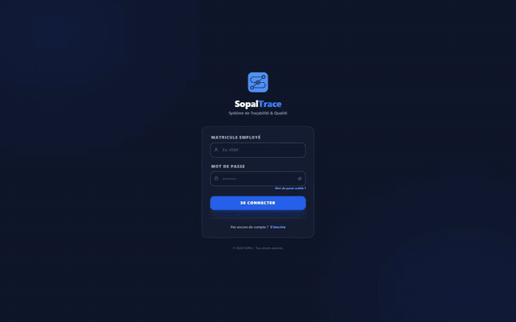
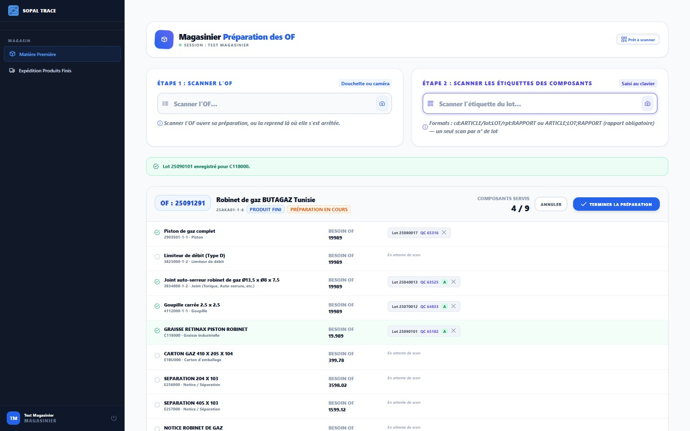
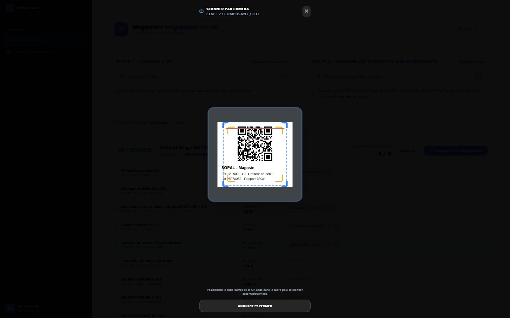
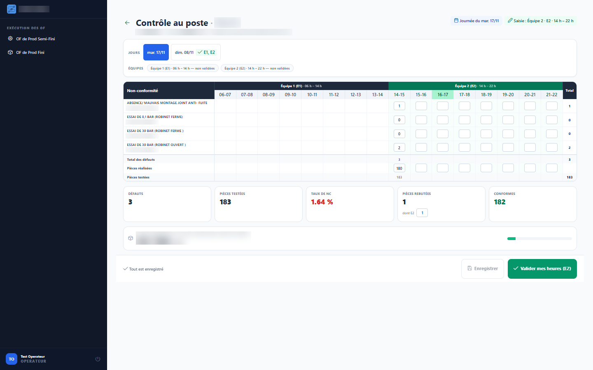
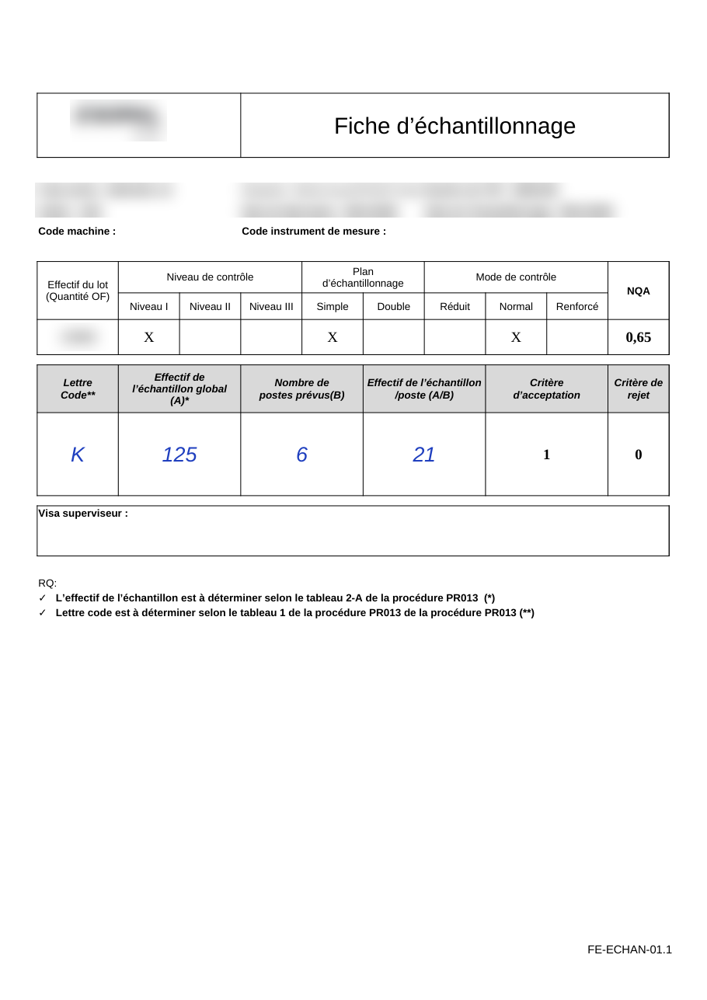
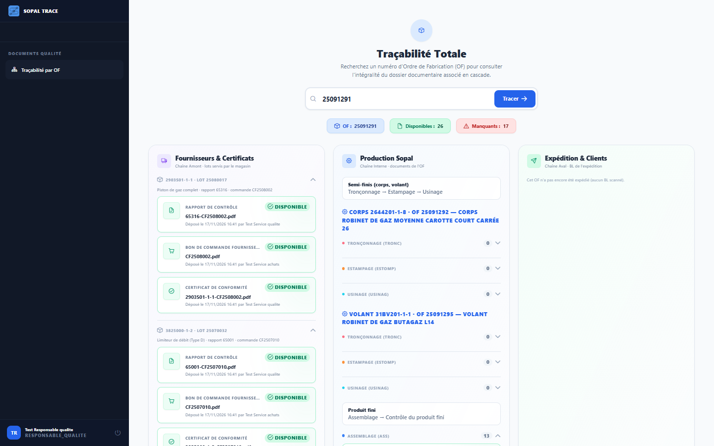

# SopalTrace — Traçabilité qualité de la production

> **Projet de fin d'études (PFE) — SOPAL, Sfax · février → septembre 2026**
> Application web de traçabilité qualité, conçue, développée et livrée pour la mise en production.
> Le code source appartient à l'entreprise et reste privé : ce dépôt présente le projet en images et en vidéo.

<a href="video/SopalTrace-demo.mp4"></a>

🎬 **[Voir la démo vidéo complète](video/SopalTrace-demo.mp4)**

---

## Le besoin

Dans SOPAL où on fabrique les robinets de bouteilles de gaz, les contrôles qualité étaient faits **sur papier et Excel** :
fiches remplies à la main, documents dispersés, et beaucoup de temps perdu pour retrouver l'historique d'un ordre de fabrication (OF).

**SopalTrace** remplace ce papier par une application web unique : chaque contrôle, chaque lot et chaque expédition est enregistré,
et la traçabilité complète d'un OF s'obtient en quelques clics.

## Ce que fait l'application

| Utilisateur | Ce qu'il fait dans l'application |
|---|---|
| **Opérateur** | Exécute les contrôles d'un OF à son poste : vérifications machine, fiches, résultats |
| **Magasinier** | Prépare les OF en **scannant les QR codes des lots** (chaque article est vérifié), puis prépare l'expédition |
| **Superviseur qualité** | Crée les plans de contrôle et les formulaires (assemblage, produit fini, échantillonnage) |
| **Responsable qualité** | Valide les documents et consulte la **traçabilité complète** de chaque OF |
| **Services** (qualité, achats, commercial…) | Déposent les documents externes : certificats, bons de commande, bons de livraison |
| **Administrateur** | Gère les comptes, les habilitations et les modèles Excel des documents |

## Les points forts en images

### Préparation des OF au magasin : scan et vérification
 

Le magasinier scanne l'OF puis chaque lot. L'application vérifie que l'article correspond à l'OF et **bloque les erreurs**.

### Contrôles au poste


### Documents qualité générés en PDF


Les rapports sont produits automatiquement à partir des modèles Excel de l'entreprise.

### Traçabilité d'un OF


> Les données affichées sont des données de test. Les informations sensibles ont été floutées.

## Ma contribution

J'ai réalisé le projet **de bout en bout** :

- **Analyse** du besoin avec les équipes qualité, magasin et production
- **Base de données** SQL Server (règles garanties par la base : contraintes, index, déclencheurs), alimentée par les données de l'ERP Sage X3
- **API REST** en .NET 8 (Clean Architecture), sécurité JWT avec 8 rôles métier
- **Interface web** en Vue.js 3 (scan QR code par caméra, tableaux, formulaires)
- **Génération des PDF** à partir de modèles Excel
- **Tests** : unitaires, intégration et recette automatique de bout en bout
- **DevOps** : intégration continue (GitHub Actions), images Docker, script d'installation automatique, et une version pour Windows Server / IIS

## Stack technique


```
navigateur ──► nginx (Vue 3) ──/api──► API .NET 8 ──► SQL Server
                                            └──────► Conversion Excel → PDF
```

---

